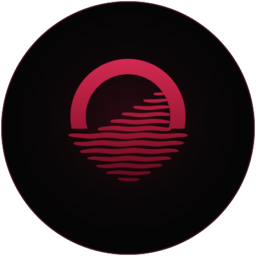

<p align="center">
  
</p>

<h1 align="center">Moonriver</h1>

<p align="center">Un escritorio negro y bordó para GNOME, pensado para programar y trabajar con agentes de IA.</p>

<p align="center"></p>

Moonriver no reemplaza GNOME: es una extensión y un conjunto de temas que lo transforman en un escritorio
al estilo de Windows/KDE, con una estética propia. Se puede quitar en cualquier momento y GNOME vuelve a como estaba.

## Qué incluye

- **Barra superior** de ancho completo con:
  - el menú de la luna (accesos a Claude Code, Antigravity, Terminal…);
  - el botón **Aplicaciones**: menú con buscador, categorías y lista de apps;
  - la **barra de tareas**: íconos teñidos de bordó, con Claude Code agrupado aparte con su logo;
  - el contador de agentes de IA activos.
- **Siempre en el escritorio:** se inicia directo en el escritorio y la tecla Super abre el menú de aplicaciones en lugar del overview.
- **Escritorio con íconos:** muestra tu carpeta Escritorio; los íconos se arrastran y quedan donde los dejás.
- **Dock inferior** con magnificación, que solo aparece cuando estás en el escritorio.
- **Moonriver Link:** app para Android y servicio para la PC que conectan el teléfono por wifi.
  - Archivos en los dos sentidos, portapapeles compartido, notificaciones del teléfono en la PC y envío de links.
  - **Control de agentes:** ver las últimas conversaciones de Claude Code y Antigravity y darles órdenes desde el celular.
- **Temas:**
  - apps GTK4 (Archivos, Configuración…) y carpetas en bordó;
  - fondo de pantalla;
  - logo en fastfetch/neofetch;
  - opcionalmente, logo Moonriver al encender y en la pantalla de login (Fedora).

## Requisitos

- GNOME 50 (probado en Fedora 44). Otras versiones pueden funcionar parcialmente.
- `python3` con PyGObject y `openssl`. Opcionales: `zenity`, `fastfetch`, `python3-pillow`.

```bash
# Fedora
sudo dnf install python3-gobject openssl zenity fastfetch python3-pillow
# Ubuntu / Debian
sudo apt install python3-gi openssl zenity fastfetch python3-pil
```

## Instalación

```bash
git clone https://github.com/Santiagoruizdiaz/moonriver.git
cd moonriver
./install.sh
```

El instalador pregunta qué partes querés (o `./install.sh --all` para todo). Al terminar, **cerrá sesión y volvé a entrar**:
en Wayland, GNOME carga las extensiones nuevas recién en el próximo inicio de sesión.

La extensión queda enlazada a esta carpeta: para actualizar, alcanza con hacer `git pull` y volver a iniciar sesión.

Logo de arranque y de login (opcional, solo Fedora, pide contraseña):

```bash
sudo ./branding/boot/install-boot-branding.sh
```

## Desinstalar

```bash
./install.sh --uninstall
sudo ./branding/boot/install-boot-branding.sh --uninstall   # si instalaste el logo de arranque
```

Si algo falla al entrar, esto desactiva Moonriver al instante:

```bash
gnome-extensions disable moonriver@moonriver.dev
```

## Moonriver Link (teléfono)

Moonriver Link viene incluido: `./install.sh` instala el servicio de la PC junto con la extensión y descarga
la app de Android del último [release](../../releases/latest). Para usarla:

1. Con el teléfono en la misma red wifi, abrí en su navegador la dirección que muestra el instalador
   (`http://IP-DE-TU-PC:41822`) e instalá la app. También aparece en el menú del teléfono del panel de Moonriver.
2. Abrí Moonriver Link, tocá tu PC y escribí el código que aparece en la pantalla de la PC.

Para darle órdenes a Claude Code desde el teléfono, el `claude` de la terminal tiene que tener sesión iniciada
(abrí `claude` una vez y usá `/login`). Para Antigravity, la app tiene que estar abierta en la PC.
Cada orden enviada desde el teléfono muestra una notificación en la PC, y el control se puede apagar desde el panel.

## Estructura

| Carpeta | Contenido |
|---|---|
| `moonriver@moonriver.dev/` | Extensión de GNOME Shell |
| `link/desktop/` | Servicio de la PC de Moonriver Link (Python) |
| `link/android/` | App de Android (Kotlin + Jetpack Compose) |
| `theme/` | Tema GTK4 e íconos |
| `branding/` | Logo, fondo de pantalla, logos de arranque y sus generadores |
| `terminal/` | Configuración de fastfetch |

## Licencia

[GPL-3.0-or-later](LICENSE).

Claude es una marca de Anthropic y Antigravity es una marca de Google. Moonriver no está afiliado a ninguna de las dos;
solo se integra con sus apps si las tenés instaladas.
